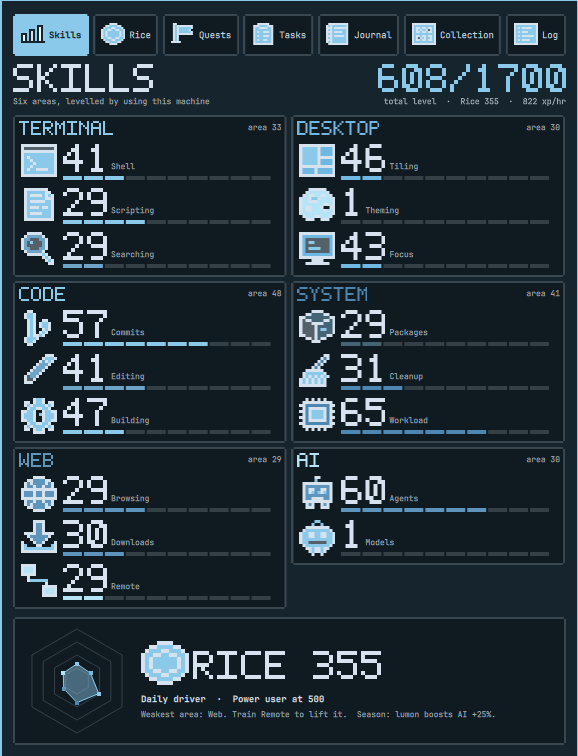

# OmaScape

Level up by using your Omarchy machine.



OmaScape is a bar widget for [Omarchy](https://omarchy.org). It watches what you actually do (commands, keybinds, commits, builds, theme changes, window moves) and turns it into XP across 17 skills in six areas: Terminal, Desktop, Code, System, Web and AI. Quests teach Omarchy, Linux and AI by having you do them. Everything is drawn as pixel art in your current theme's colours, and it all stays on your machine.

**Sizzle reel:** [16:9](https://github.com/Tiedeyez/omascape/releases/latest/download/omascape-reel-16x9.mp4) · [9:16](https://github.com/Tiedeyez/omascape/releases/latest/download/omascape-reel-9x16.mp4) · [1:1](https://github.com/Tiedeyez/omascape/releases/latest/download/omascape-reel-1x1.mp4)

## What's in it

- **17 skills in six areas**, each named for what trains it: Shell, Scripting, Searching · Tiling, Theming, Focus · Commits, Editing, Building · Packages, Cleanup, Workload · Browsing, Downloads, Remote · Agents, Models. Levels run 1 to 100 on OmaScape's own curve.
- **Rice rating.** Your six area levels drawn as a hexagon, scored 10 to 1000, with ranks from Fresh install to Omarchist. Your weakest area tells you what to train next.
- **Theme seasons.** Every Omarchy theme favours one area (+25% XP while you wear it). Wear a theme for 30 active minutes to stamp it into your passport.
- **Update Day.** Running `omarchy update` boosts System XP for an hour and gives an XP token.
- **Dotfile relics.** Commit your config (hypr, nvim, colours, shell, git, tmux ...) to unearth a relic for each.
- **Keybind tree.** Every Omarchy action you use is a node: learned at 1 use, practised at 10, mastered at 50.
- **Skins and wallpaper.** Panel frames unlock with your Rice rating, and `omascape wallpaper` draws your stats as a pixel wallpaper in your theme's colours.
- **Quests** with step-by-step helpers; most complete themselves when you do the steps.
- **Daily contracts** from the Dispatcher, **signals** (desktop riddles that solve themselves), **XP tokens**, the **Sysop's** daily "learn this command" challenge (with an optional local-AI explanation), **overclocks** (double XP on one skill for 15 minutes) and **job slots** (queue a long build or download, collect XP when it's done).
- **A journal** of four tiers (Boot, Login, Root, Kernel), **companions** that hatch at set skill levels (no luck involved), **mastery marks** at 100, and an **offline wiki** generated from the game data (`omascape wiki`).
- **Fair play.** No cap on how fast you level by using the machine, but XP that real use doesn't back up is voided (see below).

## Install

```bash
omarchy plugin add https://github.com/Tiedeyez/omascape
```

Then add `tiedeyez.omascape` to a bar section in `~/.config/omarchy/shell.json` (or the bar settings), and put the CLI on your `PATH`:

```bash
ln -s ~/.config/omarchy/plugins/tiedeyez.omascape/bin/omascape ~/.local/bin/omascape
```

Needs only Omarchy's shell and `/usr/bin/python3` (standard library). No other dependencies.

## Remove

Take `tiedeyez.omascape` out of your bar, then:

```bash
omarchy plugin remove tiedeyez.omascape
rm -f ~/.local/bin/omascape
rm -rf ~/.local/state/omascape ~/.config/omascape ~/.local/share/omascape   # your progress, settings and wiki, if you want them gone
```

## Use

Click the bar button for the panel. From a terminal:

```bash
omascape                 # your skills, by area
omascape rice            # Rice rating, rank and what to train next
omascape quests          # quest list;   omascape quest <id>  for its steps
omascape contract        # today's contract;  omascape contract new | skip
omascape season          # this theme's season, your stamps, Update Day
omascape tree            # the keybind tree
omascape relics          # dotfile relics
omascape skin rivet      # wear an unlocked panel skin
omascape wallpaper       # draw your stats as a wallpaper (then: omarchy-theme-bg-set <file>)
omascape guide shell     # a skill's guide
omascape run make -j8    # queue a long job in a job slot; omascape collect when it's done
omascape fair            # fair-play status
omascape backup          # save a copy now and list backups;  omascape restore latest
omascape wiki            # build and open the offline wiki
omascape help            # everything
```

## Settings

Optional, in `~/.config/omascape/config.json`:

```json
{
  "repos": ["~/Work/*", "~/Projects/*"],
  "offsite": "~/Sync/omascape-backups",
  "browserHistory": false,
  "shellHistory": true,
  "games": ["mygameclient"],
  "reduceMotion": false
}
```

| Key | Default | What it does |
|---|---|---|
| `repos` | `~/Work/*`, `~/Projects/*`, `~/src/*`, `~/code/*`, `~/dev/*`, `~/git/*` | Where commits (and dotfile relics) are counted. |
| `offsite` | off | A folder synced to another machine for a daily off-machine copy of your save. |
| `browserHistory` | `false` | Count Chromium visits (a number only) for the Browsing skill. |
| `shellHistory` | `true` | Read your shell history (first words only) for Shell, quests and challenges. |
| `games` | a built-in list of emulators and launchers | Extra window classes that count as playing (Focus). |
| `reduceMotion` | `false` | Turn off the pixel dissolve and hover lift. |

## Fair play

Leveling is never capped: measured activity is already paced per 30-second tick. What's voided is XP that real use doesn't back up:

- Agent awards (`omascape agent`) and manual adds share a budget of 5,000 XP plus 100 per active minute in the last 24 hours, and 30,000 per award.
- Awards across more than 6 skills in 15 minutes are voided (a sweep across every skill is the botting pattern).
- The same work can't be awarded twice in a week, and an award needs a real description.
- A machine "active" for more than 20 of the last 24 hours stops earning measured XP until the pattern breaks.
- Every XP change is tallied by source. If the save is edited by hand, the account shows as unverified.

`omascape fair` and the panel's Log tab show the status.

## Privacy

OmaScape processes activity locally. It stores counts and small command prefixes from shell history; it does not send activity anywhere. If you enable offsite backups, it writes save copies to the folder you choose, which may be synced elsewhere. The optional Sysop explanation uses a local model endpoint only when you press its button. [DISCLOSURE.md](DISCLOSURE.md) lists the exact files, data and subprocesses.

## Develop

```bash
python3 -m unittest discover -s tests     # engine tests (temporary state only)
python3 tools/contact_sheet.py ~/.local/state/omarchy/current/theme/colors.toml /tmp/icons.png
```

The engine is `skills.py` (plus `content.py` for quests and tasks, `anticheat.py` for fair play, `wallpaper.py` for the wallpaper), the panel is `Panel.qml`, the art is `icons.py` (12x12 bitmaps) and `pixelfont.py` (a 5x7 face).

## Licence

The OmaScape source, in-product artwork and the sizzle reel's music are MIT licensed; see [LICENSE](LICENSE). All in-product art and names are original to OmaScape.
